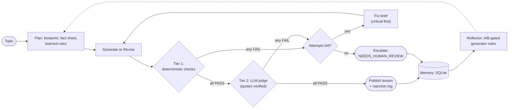

# LessonForge - self-evaluating lesson generator

Generates a beginner lesson, judges it against a hard pass/fail rubric, regenerates on failure (max 2 retries),
and outputs the passing lesson plus a rejection log. Topic for submission: **Introduction to RAG**.




## Architecture (LangGraph)
`plan -> generate -> evaluate -> publish | feedback -> generate (retry) | escalate (NEEDS_HUMAN_REVIEW)`
- **Evaluator tier 1 (deterministic):** readability (sentence length, FK incl. worst 4-sentence window), required sections and order,
  term-defined-before-use, glossary coverage, idiom blacklist, length.
- **Evaluator tier 2 (LLM judge, different model family):** claim verification vs fact sheet (A1/A2) + analogy, example, coverage, jargon, flow, idiom checks.
  Every FAIL must quote the lesson; the quote is machine-verified, otherwise it is flagged `unverified`.
- **Feedback synthesizer:** failed checks -> targeted fix brief (critical first). Revisions keep passing text unchanged and report regressions.
- **Termination:** at most 1 + `--max-retries` attempts. If still failing -> `NEEDS_HUMAN_REVIEW`, never silently shipped.

## Setup
```
python -m venv .venv && .venv\Scripts\activate      # Windows   (source .venv/bin/activate on mac/linux)
pip install -r requirements.txt
copy .env.example .env                               # then fill GROQ_API_KEY, GENERATOR, JUDGE (provider:model)
python scripts/smoke_test.py                         # both roles must print [PASS]
pytest -q                                            # offline tests (mock LLM)
```
## Run
```
python run.py --topic "Introduction to RAG"                       # normal run
python run.py --topic "Introduction to RAG" --sabotage factual    # demo: inject a deliberate false claim into attempt 1
python run.py --no-llm-judge                                      # deterministic checks only
python scripts/calibrate.py                                       # builds docs/CALIBRATION.md (evaluator catch-rate table)
```
Outputs: `outputs/lesson.md`, `outputs/rejection_log.md|json` (also in a timestamped `outputs/run_*` folder).
Sabotage modes: `factual`, `jargon`, `forward_ref`, `unsupported`.

## Memory and self-evolution
- `python run.py` records every run (attempts, check results, models used) in `data/memory.db` (SQLite). Deliberate `--sabotage` runs are recorded but never learned from.
- `python run.py --no-llm-judge --repeat 5` builds failure memory cheaply (Gemini only, no judge tokens).
- `python reflect.py run` proposes one generator-side rule per repeatedly failing check, then A/B-tests it (N lessons with vs without the rule).
  A rule becomes `active` (injected into future prompts) ONLY if its target check fails less AND total failures do not rise. Otherwise it is rejected or stays a candidate.
- The reflector can never edit the rubric, thresholds, or judge prompts, so it cannot raise its score by loosening the evaluator.
- `python reflect.py stats` / `docs/EVOLUTION.md` show failure rates, rule decisions with evidence, and first-try pass rate before/after each rules version.
- `python reflect.py feedback "..." --check C1` adds human feedback as extra evidence.

## Two setups: LAB (experiments) and FINAL (deliverable)
Free Gemini allows only ~20 requests/day (check your AI Studio rate-limit page), so spend it only where lesson quality matters.
- **LAB** (`.env.lab`, see `.env.lab.example`): local Ollama generator, no cloud generator in the chain, own memory DB. Use for repeated runs, prompt v1-vs-v2 comparison and the reflector's A/B gate:
  `$env:LESSONFORGE_ENV=".env.lab"` then `python run.py --no-llm-judge --repeat 5`, `python reflect.py run`.
- **FINAL** (`.env`): Gemini primary. Use for the submission lesson and the sabotage demo only (about 3 requests per run).
Never mix: results from different generators are not comparable (the logs and the reflector gate enforce this).

## Local fallback (Ollama)
Add it as the LAST entry of a chain, e.g. `GENERATOR=gemini:<id>,groq:openai/gpt-oss-20b,ollama:llama3.1:8b`, then run `python scripts/ollama_check.py <model>`
(checks server, model, speed, and context window). It is only used if every earlier entry fails or is out of quota. Unreachable server / missing model -> skipped with a clear message.
Every fallback that answers is printed as a WARNING at the end of a run and recorded in the log; fallback runs are not comparable with primary-model runs.

## Reliability notes (free tiers)
- Every attempt records WHICH model wrote it. If the primary generator hits a quota wall and a fallback model takes over, the rejection log shows it,
  and the reflector's A/B gate refuses to conclude from an experiment that mixed models.
- Quota walls (per-day / per-token limits) skip straight to the next provider instead of waiting; per-minute limits wait the time the API asks for.
  Calls to Gemini are paced (default 5 s apart; `MIN_INTERVAL_GEMINI=8` to slow down).
- Stagnation guard: if a revision leaves the quoted offending passages untouched, the lesson is rewritten from scratch.
- Prompt versions: `PROMPT_VERSION=v2` in `.env` (see `prompts/CHANGELOG.md` for the evidence behind each change). Judge prompts and the rubric are identical in v1 and v2.
- `python reflect.py reset --yes` wipes memory after a contaminated batch of runs.

## Status
Done: rubric, deterministic evaluator, LLM judge, generate/evaluate/regenerate loop, rejection log, sabotage mode, calibration script.
Done: SQLite memory, reflector with A/B gate, rules injection, before/after report.
Next: design-decisions doc, final lesson, demo video.


Design reasoning: `docs/DESIGN_DECISIONS.md` | Evaluator calibration: `docs/CALIBRATION.md` | Self-evolution: `docs/EVOLUTION.md` | Loom plan: `docs/LOOM_SCRIPT.md`
